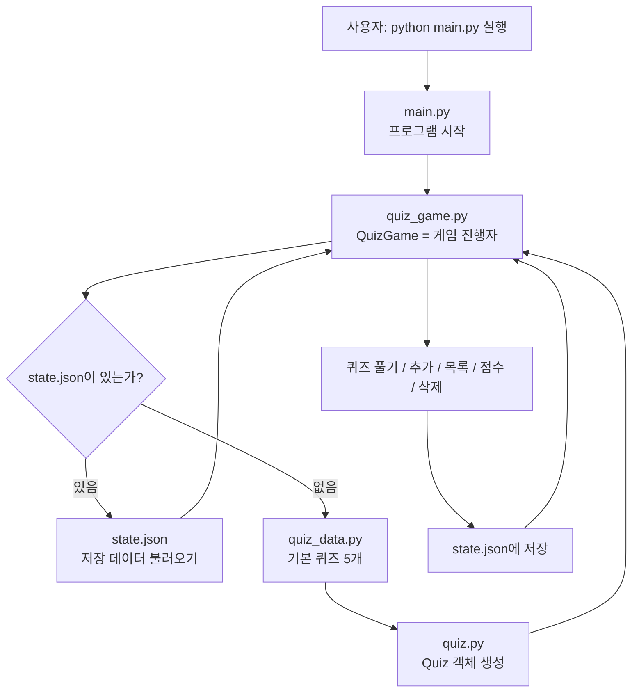
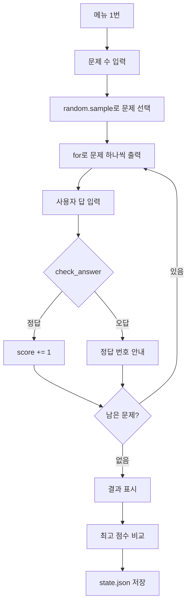

# Python & Git 퀴즈 게임

Python과 Git의 기초 개념을 직접 사용해 만든 **터미널 기반 퀴즈 게임**입니다.  
이 README는 비전공자도 위에서부터 순서대로 읽으면 **프로그램이 어떻게 시작되고, 파일들이 어떻게 연결되며, Python 문법이 실제 코드에서 어디에 쓰였는지** 이해할 수 있도록 구성했습니다.

> **한 줄로 이해하기**  
> `main.py`가 시작 → `QuizGame`이 전체 게임 진행 → `Quiz`가 문제 하나 관리 → `quiz_data.py`가 기본 문제 제공 → `state.json`이 퀴즈와 점수를 기억합니다.

---

## 과제 기준 핵심 요약

### 프로젝트 개요

이 프로젝트는 **Python 기본 문법, 클래스, JSON 파일 저장, Git/GitHub 사용법을 직접 익히기 위한 터미널 기반 퀴즈 게임**입니다. 사용자는 메뉴에서 퀴즈 풀기·추가·목록·점수 확인·종료 기능을 선택할 수 있고, 추가한 퀴즈와 점수 정보는 `state.json`에 저장됩니다.

### 퀴즈 주제와 선정 이유

- **주제:** Python과 Git 기초
- **선정 이유:** 이 미션의 핵심 목표가 Python 문법, 클래스 설계, 파일 저장, Git 사용법을 직접 이해하고 설명하는 것이므로, 학습 중인 Python·Git 개념 자체를 퀴즈 주제로 정했습니다.
- 문제의 정답을 확인하기 쉽고, 퀴즈를 풀면서 동시에 미션의 핵심 개념을 반복 학습할 수 있다는 장점이 있습니다.
- 기본 퀴즈는 5개이며 `quiz_data.py`에서 `Quiz` 클래스의 인스턴스로 생성합니다.

### 기능 목록

| 구분 | 기능 | 구현 상태 |
|---|---|---|
| 필수 | 메뉴 출력 및 번호 선택 | ✅ |
| 필수 | 퀴즈 풀기 | ✅ |
| 필수 | 퀴즈 추가 | ✅ |
| 필수 | 퀴즈 목록 | ✅ |
| 필수 | 최고 점수 확인 | ✅ |
| 필수 | 프로그램 종료 | ✅ |
| 필수 | 잘못된 입력·빈 입력·범위 밖 입력 처리 | ✅ |
| 필수 | Ctrl+C / EOF 안전 처리 | ✅ |
| 필수 | `state.json` 저장·불러오기 | ✅ |
| 필수 | 파일 미존재·손상 시 기본 데이터 복구 | ✅ |
| 보너스 | 랜덤 출제 | ✅ |
| 보너스 | 문제 수 선택 | ✅ |
| 보너스 | 힌트 표시 | ✅ |
| 보너스 | 퀴즈 삭제 | ✅ |
| 보너스 | 점수 기록 목록 | ✅ |
| 보너스 | 힌트 사용 시 점수 차감 | ❌ 미구현 |
| 보너스 | 점수 기록에 날짜·시간 저장 | ❌ 미구현 |

> 보너스 과제는 선택사항입니다. 위 표는 현재 실제 코드에서 확인되는 범위만 표시했습니다.

---

## 1. 전체 구조부터 이해하기

파일 이름보다 먼저 **사람의 역할**로 생각하면 쉽습니다.

| 파일 | 쉬운 비유 | 실제 역할 |
|---|---|---|
| `main.py` | 🚪 시작 버튼 | 프로그램 시작, `QuizGame` 실행 |
| `quiz_game.py` | 👩‍🏫 게임 진행자 | 메뉴·퀴즈·점수·추가·삭제·저장 전체 관리 |
| `quiz.py` | 📝 문제 한 장의 설계도 | 문제·보기·정답·힌트와 정답 확인 |
| `quiz_data.py` | 📚 기본 문제집 | 처음 사용할 기본 퀴즈 5개 제공 |
| `state.json` | 💾 저장장부 | 추가 퀴즈·최고 점수·점수 기록 저장 |

### 전체 구조 도식



### 실제 실행 흐름

```text
1. 사용자가 python main.py를 실행한다.
2. main.py가 QuizGame 객체를 만든다.
3. QuizGame의 __init__이 자동 실행된다.
4. state.json이 있는지 확인한다.
5. 있으면 이전 퀴즈와 점수를 불러온다.
6. 없으면 quiz_data.py의 기본 퀴즈 5개를 가져온다.
7. quiz_game.py가 메뉴를 보여주고 게임을 진행한다.
8. 퀴즈·점수가 바뀌면 state.json에 저장한다.
9. 다음 실행 때 저장된 내용을 다시 불러온다.
```

---

## 2. `main.py` — 프로그램의 시작 버튼

```python
from quiz_game import QuizGame

def main():
    game = QuizGame()
    game.run()

if __name__ == "__main__":
    main()
```

| 코드 | 쉬운 설명 |
|---|---|
| `from quiz_game import QuizGame` | 다른 파일에 있는 `QuizGame` 설계도를 가져옴 |
| `def main():` | 시작할 일을 `main`이라는 함수로 묶음 |
| `game = QuizGame()` | 설계도로 실제 게임 객체 하나를 만듦 |
| `game.run()` | 만들어진 게임에게 “게임을 시작해”라고 명령 |
| `if __name__ == "__main__":` | 이 파일을 직접 실행했을 때 `main()` 실행 |

```text
python main.py
      ↓
main.py
      ↓
game = QuizGame()
      ↓
게임 객체 생성
      ↓
game.run()
      ↓
메뉴 시작
```

---

## 3. 클래스, `__init__`, `self`, 인스턴스화

이 프로젝트에는 핵심 클래스가 **2개** 있습니다.

- `Quiz` = 문제 한 문제의 설계도
- `QuizGame` = 게임 전체의 설계도

### 3-1. 클래스(Class) = 설계도

`class`는 실제 물건이 아니라 **어떤 정보와 기능을 가질지 미리 정한 틀**입니다.

```python
class Quiz:
    def __init__(self, question, choices, answer, hint=""):
        self.question = question
        self.choices = choices
        self.answer = answer
        self.hint = hint
```

```text
Quiz 설계도
 ├─ 문제(question)
 ├─ 보기(choices)
 ├─ 정답(answer)
 └─ 힌트(hint)
```

### 3-2. `__init__` = 처음 준비하기

`__init__`은 객체를 만들 때 **자동으로 실행되어 처음 값을 넣어주는 메서드**입니다.

```text
Quiz(...) 실행
    ↓
Quiz 객체 생성
    ↓
__init__ 자동 실행
    ↓
문제·보기·정답·힌트 저장
```

### 3-3. `self` = 지금 이 객체 자신

```python
self.question = question
```

쉬운 말로 하면 **“지금 만들고 있는 이 퀴즈의 question에 전달받은 문제를 저장한다.”**는 뜻입니다.

### 3-4. 인스턴스화 = 설계도로 실제 객체 만들기

```python
quiz1 = Quiz(
    "Python 출력 함수는?",
    ["input()", "print()", "len()", "type()"],
    2,
)
```

- `Quiz` → 클래스(설계도)
- `Quiz(...)` → 인스턴스화(실제 객체를 만드는 과정)
- `quiz1` → 인스턴스(실제로 만들어진 객체)

`main.py`의 `game = QuizGame()`도 같은 원리입니다.

> **암기:** 클래스 = 설계도 / 인스턴스화 = 실제 객체 만들기 / 인스턴스 = 만들어진 실제 객체

### 3-5. 클래스·인스턴스화·상속·다형성 학습 정리

첨부 학습자료의 핵심은 다음 네 개념을 한 흐름으로 이해하는 것입니다.

| 개념 | 쉬운 뜻 | 기억할 말 |
|---|---|---|
| 클래스(Class) | 객체를 만들기 위한 틀 | 설계도 |
| 인스턴스화(Instantiation) | 클래스로 실제 객체를 만드는 과정 | 실제 물건 만들기 |
| 상속(Inheritance) | 부모 클래스의 기능을 자식 클래스가 이어받음 | 기능 물려받기 |
| 다형성(Polymorphism) | 같은 메서드가 객체에 따라 다르게 동작 | 같은 명령, 다른 동작 |

```text
1. 클래스
   Quiz라는 설계도를 만든다
          ↓
2. 상속
   HintQuiz가 Quiz의 기능을 물려받는다
          ↓
3. 인스턴스화
   q1 = Quiz(...)
   q2 = HintQuiz(...)
   실제 객체를 만든다
          ↓
4. 다형성
   q1.show()
   q2.show()
   같은 show() 명령도 객체에 따라 다르게 동작할 수 있다
```

#### 상속 예시

```python
class Quiz:
    def show(self):
        print(self.question)

class HintQuiz(Quiz):
    def show_hint(self):
        print("힌트:", self.hint)
```

`HintQuiz(Quiz)`에서 괄호 안의 `Quiz`는 **Quiz를 부모 클래스로 상속받겠다**는 뜻입니다. 부모 클래스가 없어지는 것이 아니라, 자식 클래스가 부모 기능을 이용하면서 자신의 기능을 추가할 수 있습니다.

#### 다형성 예시

```python
class TextQuiz:
    def show(self):
        print("글자 문제를 보여줍니다")

class ImageQuiz:
    def show(self):
        print("그림 문제를 보여줍니다")

quizzes = [TextQuiz(), ImageQuiz()]

for quiz in quizzes:
    quiz.show()
```

둘 다 `quiz.show()`라는 같은 명령을 사용하지만, `TextQuiz`는 글자 문제를, `ImageQuiz`는 그림 문제를 보여줄 수 있습니다.

> **중요 — 현재 프로젝트와 구분하기**  
> 현재 실제 퀴즈게임에서 확인되는 것은 `class Quiz`, `class QuizGame`, `Quiz(...)`, `game = QuizGame()`, `__init__`입니다. 현재 코드에는 `Quiz`를 부모로 둔 별도의 자식 클래스가 없으므로 **상속과 다형성은 현재 구현 기능이 아니라 개념 학습을 위한 확장 예시**입니다.

#### 평가 때 짧게 답하기

- **클래스**: 객체를 만들기 위한 설계도입니다.
- **인스턴스화**: 클래스를 이용해 실제 객체를 만드는 과정입니다.
- **인스턴스**: 클래스로부터 실제 만들어진 각각의 객체입니다.
- **상속**: 부모 클래스의 속성과 기능을 자식 클래스가 물려받아 재사용하거나 확장하는 것입니다.
- **다형성**: 같은 이름의 메서드를 호출해도 객체 종류에 따라 다르게 동작할 수 있는 성질입니다.
- **`__init__`**: 객체 생성 시 자동 실행되어 초기값을 설정하는 메서드입니다.
- **`self`**: 현재 만들어진 객체 자기 자신을 가리킵니다.

> **최종 암기:** 클래스 = 설계도 / 인스턴스화 = 실제 객체 만들기 / 상속 = 기능 물려받기 / 다형성 = 같은 명령, 다른 동작

---
### 📘 추가 학습자료

클래스, 인스턴스화, 상속, 다형성을 초보자도 이해하기 쉽게 정리한 PDF입니다.

➡️ [파이썬 클래스·인스턴스화·상속·다형성 학습자료 PDF 보기](docs/python_class_guide.pdf)

## 4. `quiz.py` — 문제 한 개 담당

`Quiz` 클래스는 문제 한 개를 책임집니다.

| 속성 | 의미 | 예시 |
|---|---|---|
| `question` | 문제 내용 | Python 출력 함수는? |
| `choices` | 보기 4개 | input(), print(), len(), type() |
| `answer` | 정답 번호 | 2 |
| `hint` | 힌트 | 화면에 보여주는 함수를 생각하세요 |

### `display()` — 문제 보여주기

```python
def display(self):
    print(f"\n문제: {self.question}")
    for index, choice in enumerate(self.choices, start=1):
        print(f"{index}. {choice}")
```

`for` 반복문으로 보기 4개를 하나씩 출력합니다.

### `check_answer()` — 정답 확인

```python
def check_answer(self, user_answer):
    return user_answer == self.answer
```

사용자 답과 정답을 `==`로 비교합니다. 같으면 `True`, 다르면 `False`입니다.

### `to_dict()`, `from_dict()`

- `to_dict()` → `Quiz` 객체를 JSON에 저장 가능한 `dict`로 변경
- `from_dict()` → JSON에서 읽은 `dict`를 다시 `Quiz` 객체로 복원

---

## 5. `quiz_data.py` — 기본 문제집

처음 사용할 기본 문제 5개가 들어 있습니다.

```python
def get_default_quizzes():
    return [
        Quiz(...),
        Quiz(...),
        Quiz(...),
        Quiz(...),
        Quiz(...),
    ]
```

```text
quiz.py
= "퀴즈는 이런 모양이어야 한다"는 문제 양식

quiz_data.py
= 그 양식으로 실제 내용을 채운 기본 문제집
```

`Quiz(...)`가 실행될 때 실제 `Quiz` 객체가 만들어지고 `__init__`이 자동 실행됩니다.

---

## 6. `quiz_game.py` — 게임 전체 진행자

```python
class QuizGame:
    def __init__(self):
        self.state_file = Path(__file__).resolve().parent / "state.json"
        self.quizzes = []
        self.best_score = None
        self.score_history = []
        self.load_state()
```

```text
QuizGame() 생성
      ↓
퀴즈 목록 준비
      ↓
최고 점수 저장 공간 준비
      ↓
점수 기록 준비
      ↓
load_state()
      ↓
이전에 저장한 데이터 확인
```

### Quiz와 QuizGame의 차이

```text
Quiz
└─ 문제 한 문제
   ├─ 문제
   ├─ 보기
   ├─ 정답
   └─ 정답 확인

QuizGame
└─ 게임 전체
   ├─ 여러 Quiz 보관
   ├─ 메뉴
   ├─ 퀴즈 진행
   ├─ 추가·삭제
   ├─ 점수
   └─ JSON 저장·불러오기
```

---

## 7. 조건문과 반복문은 어디에 쓰였나?

### `for` = 정해진 데이터를 하나씩 반복

```python
for number, quiz in enumerate(selected_quizzes, start=1):
```

선택된 퀴즈를 첫 문제부터 마지막 문제까지 하나씩 처리합니다.

### `while` = 언제 끝날지 모르는 반복

메뉴나 입력 검증처럼 **올바른 입력이 들어올 때까지** 반복할 때 사용합니다.

```python
while True:
```

### `if / elif / else` = 조건에 따라 다른 행동

```python
if choice == "1":
    self.play_quiz()
elif choice == "2":
    self.add_quiz()
elif choice == "5":
    break
else:
    print("잘못된 입력입니다.")
```

- `break` → 반복을 완전히 종료
- `continue` → 이번 차례를 넘기고 다시 반복

---

## 8. 입력 오류와 `try / except`

사용자는 빈칸, `abc`, `0`, `9`, Ctrl+C 등을 입력할 수 있습니다.

```python
while True:
    try:
        value = input(prompt).strip()
        number = int(value)
        return number
    except ValueError:
        print("숫자만 입력하세요.")
```

| 코드 | 의미 |
|---|---|
| `.strip()` | 앞뒤 공백 제거 |
| `int(value)` | 문자열을 정수로 변환 |
| `try` | 오류 가능 코드 실행 |
| `except ValueError` | 숫자로 바꿀 수 없는 입력 처리 |
| `KeyboardInterrupt` | Ctrl+C 처리 |
| `EOFError` | 입력이 비정상적으로 끝난 경우 처리 |

> `try / except`를 사용하면 잘못된 입력 때문에 프로그램 전체가 갑자기 종료되는 것을 막을 수 있습니다.

---

## 9. `state.json` — 프로그램의 기억장치

Python 변수의 값은 프로그램 종료 후 사라지므로 퀴즈와 점수를 파일에 저장합니다.

```text
게임 중 데이터
      ↓
save_state()
      ↓
state.json
      ↓
프로그램 종료
      ↓
다음 실행
      ↓
load_state()
      ↓
이전 데이터 복구
```

예시:

```json
{
  "quizzes": [
    {
      "question": "Python에서 화면에 내용을 출력할 때 사용하는 함수는?",
      "choices": ["input()", "print()", "len()", "type()"],
      "answer": 2,
      "hint": "화면에 결과를 보여 주는 출력 함수를 떠올려 보세요."
    }
  ],
  "best_score": 5,
  "score_history": [
    {"score": 5, "total": 5}
  ]
}
```

- `json.dump()` = Python 데이터를 JSON 파일에 **저장**
- `json.load()` = JSON 파일을 Python 데이터로 **불러오기**

### `state.json`이 없으면?

```text
state.json 없음
      ↓
get_default_quizzes()
      ↓
기본 문제 5개
      ↓
새 state.json 저장
```

### 파일이 손상되면?

`JSONDecodeError`, `OSError`, `KeyError`, `TypeError`, `ValueError` 등을 처리해 기본 퀴즈로 복구합니다.

> **평가 답변:** “state.json이 없으면 기본 퀴즈를 불러온 뒤 새로운 저장 파일을 생성합니다.”

### 실제 저장 스키마

현재 프로그램의 `save_state()`는 다음 세 항목을 저장합니다.

| 필드 | 의미 |
|---|---|
| `quizzes` | 문제·선택지·정답·힌트가 들어 있는 퀴즈 목록 |
| `best_score` | 지금까지의 최고 정답 수 |
| `score_history` | 각 게임의 정답 수와 출제 문제 수 기록 |

`state.json`은 **프로젝트 루트**에 저장하며, `encoding="utf-8"`과 `ensure_ascii=False`를 사용합니다. 예전 형식의 JSON에 `hint`나 `score_history`가 없어도 기본값을 사용하도록 호환 처리되어 있습니다.

---

## 10. 퀴즈 풀기 흐름



```python
score = 0

if quiz.check_answer(answer):
    score += 1
```

`score += 1`은 `score = score + 1`과 같은 뜻입니다.

---

## 11. 퀴즈 추가와 삭제

### 추가

```text
문제 입력
  ↓
보기 4개
  ↓
정답 1~4
  ↓
힌트
  ↓
Quiz(...) 객체 생성
  ↓
append()
  ↓
save_state()
```

`append()`는 리스트 마지막에 새 항목을 추가합니다.

### 삭제

```python
deleted = self.quizzes.pop(number - 1)
```

`pop()`은 리스트에서 해당 항목을 삭제합니다. Python 리스트는 0부터 시작하므로 사용자가 선택한 번호에서 1을 뺍니다.

---

## 12. 현재 메뉴

```text
================================
     Python & Git 퀴즈 게임
================================
1. 퀴즈 풀기
2. 퀴즈 추가
3. 퀴즈 목록
4. 점수 확인
5. 종료
6. 퀴즈 삭제 (보너스)
7. 점수 기록 (보너스)
================================
```

기본 기능은 1~5이고, 6~7은 보너스 기능입니다.

---

## 13. 실행 방법

### 처음 내려받을 때

```powershell
git clone https://github.com/soyeon74/python-quiz-game.git
cd python-quiz-game
python main.py
```

### 기존 프로젝트 폴더에서

```powershell
cd "C:\Users\외부망\Desktop\이것저것\python-quiz-game"
python main.py
```

`python` 명령이 안 되면:

```powershell
py main.py
```

개발·검증 환경: Windows / PowerShell / VS Code / Python 3.12.10

---

## 14. 프로젝트 파일 구조

```text
python-quiz-game/
├─ main.py              # 프로그램 시작
├─ quiz.py              # Quiz 클래스
├─ quiz_data.py         # 기본 퀴즈 5개
├─ quiz_game.py         # QuizGame 클래스, 게임 전체 관리
├─ state.json           # 퀴즈·점수 저장
├─ README.md            # 설명 및 학습 자료
├─ docs/
│  └─ python_class_guide.pdf  # 클래스·인스턴스화·상속·다형성 추가 학습자료
└─ .gitignore           # Git 제외 파일 설정
```

---

## 15. 이 프로젝트에서 사용한 Python 핵심 개념

| 개념 | 쉬운 뜻 | 사용 위치 |
|---|---|---|
| `class` | 객체 설계도 | `Quiz`, `QuizGame` |
| `__init__` | 처음 값 준비 | 두 클래스 생성 시 |
| `self` | 현재 객체 자신 | 객체 속성·메서드 |
| `def` | 함수/메서드 만들기 | 게임 기능들 |
| `list` | 여러 값을 순서대로 저장 | 퀴즈 목록, 보기 |
| `dict` | key-value 쌍 | JSON 저장 데이터 |
| `if/elif/else` | 조건 분기 | 메뉴, 정답 판정 |
| `for` | 정해진 항목 반복 | 문제·보기 출력 |
| `while` | 조건이 맞을 때까지 반복 | 메뉴·입력 검증 |
| `break` | 반복 종료 | 메뉴 종료 |
| `continue` | 다시 반복 | 잘못된 입력 |
| `return` | 결과 반환 | 입력값·정답 결과 |
| `try/except` | 오류 안전 처리 | 입력·JSON |
| `append()` | 리스트 추가 | 퀴즈·점수 기록 |
| `pop()` | 리스트 삭제 | 퀴즈 삭제 |
| `json.dump()` | JSON 저장 | `save_state()` |
| `json.load()` | JSON 읽기 | `load_state()` |

---

## 16. Git / GitHub 이해하기

**Git**은 코드 변경 과정을 기록하는 버전 관리 도구이고, **GitHub**는 Git 저장소를 온라인에 보관·공유하는 서비스입니다.

| 명령어 | 쉬운 뜻 |
|---|---|
| `git init` | Git 관리 시작 |
| `git add` | 기록할 변경 준비 |
| `git commit` | 로컬에 버전 기록 |
| `git push` | GitHub에 업로드 |
| `git checkout` | 브랜치 생성·이동 |
| `git clone` | 저장소를 처음 통째로 복사 |
| `git pull` | 기존 저장소에 최신 변경 가져오기 |

```text
파일 수정
   ↓
git add
   ↓
git commit
   ↓
git push
   ↓
GitHub
```

- `clone` = 내 PC에 저장소가 없을 때 처음 복사
- `pull` = 이미 있는 저장소를 최신 상태로 업데이트

---

## 17. Git / GitHub 수행 내역

- `git init`, `add`, `commit`, `checkout`, `push`, `clone`, `pull` 수행
- `feature/quiz-play` 브랜치 생성 후 `main` 병합
- `feature/bonus-features`에서 보너스 기능 개발 후 병합
- 별도 폴더 clone → README 수정 → push → 원본에서 pull
- 10개 이상의 의미 있는 커밋 작성

대표 이력:

```text
bd6b7c3 Docs: clone 환경에서 README 수정
1e9ce89 Docs: 프로젝트 실행 방법 및 데이터 구조 문서화
c1b7c4a Fix: QuizGame 메뉴 실행 구조 오류 수정
f08f671 Refactor: QuizGame 중심으로 메뉴 실행 구조 정리
9c0c21a Feat: state.json 데이터 저장 및 최고 점수 유지 구현
342dc9b Feat: 퀴즈 추가 및 목록 조회 기능 구현
90e288c Feat: 사용자 퀴즈 추가 기능 구현
f773e6d Merge: 퀴즈 플레이 기능 브랜치 병합
985dac0 Feat: 퀴즈 출제 및 점수 계산 기능 구현
3bdf3af Feat: Python과 Git 기본 퀴즈 5문제 추가
65ddda1 Feat: Quiz 클래스 및 정답 확인 기능 구현
42e30e3 Feat: 퀴즈 게임 메뉴 및 입력 예외 처리 구현
12a6353 Chore: 프로젝트 초기 구조 설정
```

브랜치·병합 기록 확인:

```powershell
git log --oneline --graph --decorate --all
```

---

## 18. 보너스 기능

- `random.sample()` 문제 랜덤 출제
- 원하는 문제 수 선택
- 풀이 중 `h` 입력 시 힌트
- 메뉴 6 퀴즈 삭제
- 메뉴 7 점수 기록 조회
- 기존 JSON에 `hint`, `score_history`가 없어도 동작하도록 호환 처리

---

## 19. 최종 검증 항목

- 기본 퀴즈 5개 이상
- 퀴즈 풀기·추가·목록·점수 확인
- 정답/오답 판정
- 재실행 후 추가 퀴즈·점수 유지
- 빈 입력·문자·범위 밖 입력 처리
- Ctrl+C / EOF 처리
- `state.json` 미존재 시 기본 데이터 생성
- 손상 JSON 복구
- 10개 이상 의미 있는 커밋
- 브랜치 생성·병합
- clone / pull 실습

---

## 20. 평가 전에 말할 수 있어야 하는 핵심 답변

**Q. 전체 구조는?**  
> `main.py`가 시작하고 `QuizGame`이 게임 전체를 관리합니다. 각 문제는 `Quiz` 객체로 관리하고, 기본 문제는 `quiz_data.py`에서 가져오며, 추가 문제와 점수는 `state.json`에 저장합니다.

**Q. 클래스란?**  
> 객체를 만들기 위한 설계도입니다. 이 프로젝트에는 `Quiz`와 `QuizGame` 클래스가 있습니다.

**Q. `__init__`은?**  
> 객체가 생성될 때 자동 실행되어 처음 필요한 값을 설정하는 메서드입니다.

**Q. `self`는?**  
> 현재 만들어진 객체 자기 자신을 가리킵니다.

**Q. 인스턴스화란?**  
> 클래스를 이용해 실제 객체를 만드는 과정입니다. `Quiz(...)`, `QuizGame()`이 예입니다.

**Q. JSON은 왜 사용했나?**  
> 프로그램을 종료해도 추가한 퀴즈와 점수가 유지되도록 파일에 저장하기 위해 사용했습니다.

**Q. state.json을 삭제하면?**  
> 기본 퀴즈를 불러오고 새로운 `state.json`을 생성합니다.

**Q. for와 while의 차이는?**  
> `for`는 정해진 데이터를 하나씩 반복하고, `while`은 메뉴나 입력처럼 언제 끝날지 모르는 반복에 사용합니다.

**Q. Git과 GitHub의 차이는?**  
> Git은 변경 이력을 관리하는 도구이고 GitHub는 Git 저장소를 온라인에 보관하고 공유하는 서비스입니다.

---

## 21. 과제 제출 증빙 정리

과제 원문은 코드뿐 아니라 **실행 화면과 Git 작업 증거 스크린샷**도 제출하도록 요구합니다. 저장소의 코드와 Git 이력으로 확인되는 내용과, 별도로 캡처가 필요한 내용을 구분합니다.

| 제출 증빙 | 현재 확인 내용 | 제출 시 할 일 |
|---|---|---|
| 개발 환경 | Python 3.12.10 사용 기록 | VS Code·Python 버전·Git 설정 화면 캡처 첨부 |
| 프로그램 실행 | 메뉴·추가·목록·플레이·점수 기능 구현 확인 | 실제 실행 화면 캡처 첨부 |
| Git 이력 | 10개 이상 의미 있는 커밋 확인 | `git log --oneline --graph --decorate --all` 화면 캡처 첨부 |
| 브랜치·병합 | `feature/quiz-play`, `feature/bonus-features` 작업 및 병합 기록 | Git graph 화면에서 병합 기록이 보이게 캡처 |
| clone / pull | 별도 clone 후 README 변경·push·기존 폴더 pull 실습 기록 | 필요 시 터미널 화면 캡처 첨부 |
| 학습자료 | `docs/python_class_guide.pdf` | README 링크 연결 완료 |

권장 스크린샷 경로는 과제 예시에 맞춰 다음처럼 사용할 수 있습니다.

```text
docs/screenshots/
├─ environment.png
├─ menu.png
├─ add_quiz.png
├─ list.png
├─ play.png
├─ score.png
└─ git-log.png
```

> **주의:** 위 경로는 제출용 권장 구조입니다. 실제 이미지 파일이 저장소에 업로드되기 전에는 README에서 캡처가 존재한다고 표시하지 않습니다.

### Docker 실습과 이번 미션의 관계

이전 개발 워크스테이션 실습에서 Docker 이미지·컨테이너 실행을 학습했지만, **이번 「컴퓨터에게 명령 내리는 말(파이썬) 처음 배우기」 과제의 필수 요구사항에는 Docker가 없습니다.** 따라서 Docker를 이 퀴즈 프로그램의 구현 기능이나 필수 제출 증빙으로 표시하지 않습니다. 필요하면 별도의 개발환경 학습 증빙으로 추가할 수 있습니다.

---

## 22. 제출 요구사항 체크

| 요구사항 | 결과 |
|---|---|
| Python 3.10+ | ✅ Python 3.12.10 검증 |
| 표준 라이브러리 | ✅ |
| 기본 메뉴 5종 | ✅ |
| 기본 퀴즈 5개 이상 | ✅ |
| `Quiz` / `QuizGame` 2개 클래스 | ✅ |
| 선택지 4개·정답 1~4 | ✅ |
| 입력값 검증 | ✅ |
| Ctrl+C / EOF 처리 | ✅ |
| `state.json` 영구 저장 | ✅ |
| 미존재/손상 파일 복구 | ✅ |
| 의미 있는 커밋 10개 이상 | ✅ |
| 별도 브랜치 및 merge | ✅ |
| push / clone / pull | ✅ |
| 선택 보너스 기능 | ✅ 랜덤 출제·문제 수 선택·힌트 표시·삭제·점수 기록 목록 구현 (힌트 점수차감·날짜/시간 기록은 미구현) |

---

## 23. GitHub 저장소

https://github.com/soyeon74/python-quiz-game

---

## 마지막 한 줄 정리

> **`main.py` = 시작 → `QuizGame` = 게임 진행 → `Quiz` = 문제 한 개 → `quiz_data.py` = 기본 문제집 → `state.json` = 저장장부**

이 흐름을 이해하면 클래스, 객체, 함수, 조건문, 반복문, 예외 처리, JSON 저장이 이 프로그램에서 왜 필요한지 하나의 이야기로 설명할 수 있습니다.
